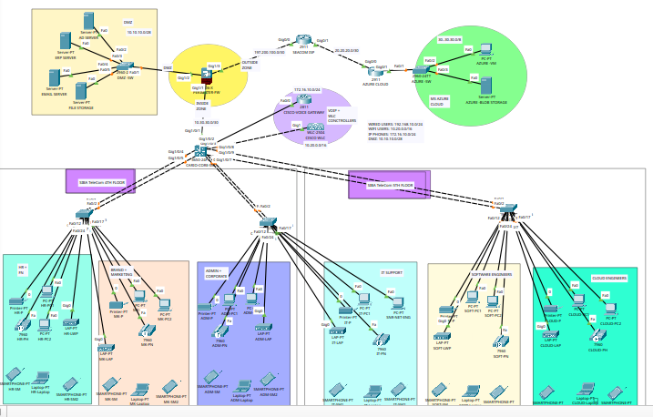
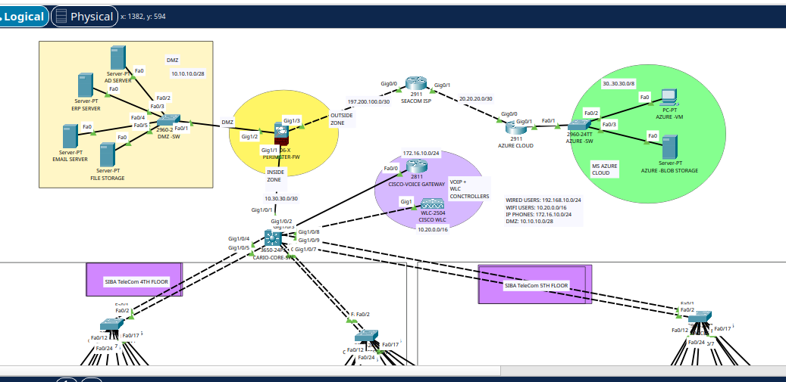
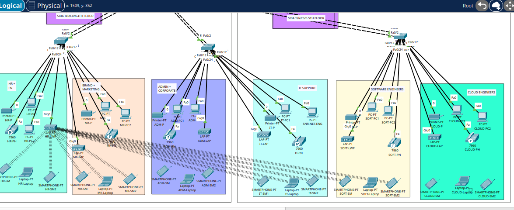

# Telecommunication Network Design using Cisco Packet Tracer

## Overview

This project was developed as part of the **Computer Networks** course at **Sukkur IBA University**.

The objective was to design and simulate a secure enterprise telecommunication network using **Cisco Packet Tracer**. The network connects multiple departments across two floors while providing secure communication, resource sharing, dynamic routing, wireless connectivity, and VoIP services.

## Features

- Multi-floor enterprise network architecture
- VLAN segmentation
- Inter-VLAN communication
- OSPF dynamic routing
- DHCP configuration
- Wireless LAN connectivity
- VoIP (IP Telephony)
- Cisco ASA Firewall configuration
- SSH remote access
- Switch Port Security
- EtherChannel configuration
- Spanning Tree Protocol (STP)
- Network testing and verification

## Technologies Used

- Cisco Packet Tracer
- Computer Networking
- VLAN
- OSPF
- DHCP
- Cisco ASA Firewall
- VoIP
- Wireless LAN
- SSH
- EtherChannel
- STP

## Network Screenshots

The following screenshots demonstrate the network topology, configurations, and simulation of the enterprise telecommunication network.

### Screenshot 1

### Screenshot 2

### Screenshot 3

## Project Files

- **Packet Tracer Simulation:** `.pkt`
- **Project Report:** PDF
- **Network Screenshots:** SS1, SS2, SS3

## Author

**Ishtiaque Ali**

BS Computer Science Student  
Sukkur IBA University